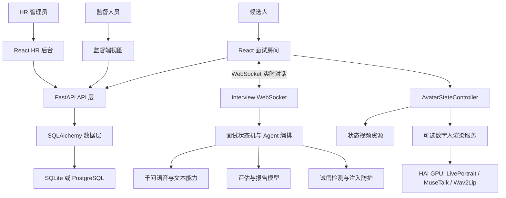
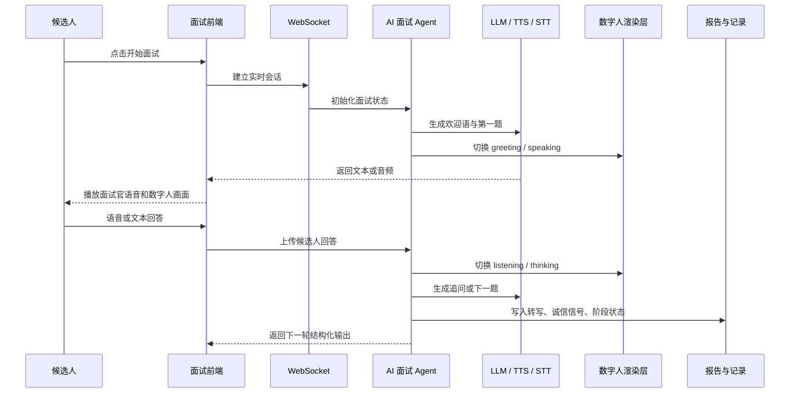

<div align="center">
  
  <h1>菜鸟庆 AI 面试系统</h1>
  <p><strong>面向 HR、候选人和监督人员的 AI 面试编排平台。</strong></p>
  <p>AI 面试官、实时语音对话、候选人诚信检测、监督端观察、结构化评分报告与可替换数字人渲染层。</p>
</div>

<div align="center">


[项目定位](#项目定位) ·
[线上 Demo](https://frontend-378x0vvu9-xiaming0707-7659s-projects.vercel.app/interview) ·
[系统架构](#系统架构) ·
[核心能力](#核心能力) ·
[快速开始](#快速开始) ·
[环境变量](#环境变量) ·
[核心-api](#核心-api) ·
[质量门禁](#质量门禁) ·
[部署](#部署) ·
[安全边界](#安全边界) ·
[Roadmap](#roadmap)

</div>

> [!IMPORTANT]
> 本项目是一个模块化 AI 面试系统。当前核心可交付能力是面试会话编排、HR 后台、监督端、实时语音链路、诚信检测、评分报告和可替换数字人渲染接口。数字人层采用分层策略：生产界面可先使用稳定的视频状态资源，后续可无缝替换为 LivePortrait、MuseTalk、Wav2Lip、LiveAvatar、HeyGen 或自研 GPU 渲染服务。

> [!WARNING]
> HAI GPU 实例只应该在需要生成或调试数字人视频时开机。按小时计费的实例用完必须立即关机，避免产生不必要成本。

> [!NOTE]
> 仓库默认分支在不同远端可能不是当前完整开发分支。发布、合并或部署前，请确认当前分支包含 `backend`、`frontend`、`services`、`render.yaml` 和测试目录。

## 项目定位

菜鸟庆 AI 面试系统的目标不是做一个简单问答页面，而是构建一套可商业化交付的 AI 面试基础设施。系统围绕一次真实面试的完整生命周期设计：HR 创建岗位和候选人面试链接，候选人进入面试间，AI 面试官完成开场、提问、追问、倾听和结束，监督人员可旁路观察，后台沉淀实时记录、诚信信号和结构化评估报告。

系统采用可替换架构。LLM、TTS、STT、数字人渲染、评分模型、存储和部署平台都通过清晰边界隔离，后续可以从本地演示资源升级到 GPU 数字人服务，也可以从 SQLite 升级到 PostgreSQL，从 Render 单体部署升级到服务拆分。

## Demo 与入口

| 入口 | 默认地址 | 用途 |
| --- | --- | --- |
| 线上 Demo | [Vercel Interview Demo](https://frontend-378x0vvu9-xiaming0707-7659s-projects.vercel.app/interview) | 当前已验证可访问的候选人面试演示入口 |
| Render 一体化服务 | `https://cainiaoqing-interview.onrender.com` | 如已启用，可同时承载前端、API 和 WebSocket |
| 一体化应用 | `http://localhost:8000` | FastAPI 托管 API 与前端构建产物 |
| 前端开发服务 | `http://localhost:5173` | Vite 本地开发与快速 UI 调试 |
| API 健康检查 | `http://localhost:8000/api/health` | 部署与监控探活 |
| OpenAPI 文档 | `http://localhost:8000/docs` | FastAPI 自动生成接口文档 |
| 面试页 | `/interview` | 候选人面试房间 |
| HR 后台 | `/admin` | 岗位、候选人、题库、记录与报告管理 |

> [!CAUTION]
> 本地开发时，浏览器摄像头和麦克风权限可能受 `localhost`、HTTPS、安全策略和浏览器设置影响。候选人端应明确展示授权失败提示，但不能阻塞只读演示模式。

## 系统架构



### 面试运行时序



## 核心能力

| 领域 | 已实现能力 | 设计边界 |
| --- | --- | --- |
| HR 后台 | 岗位管理、候选人会话、题库、记录、报告入口 | 管理端接口需通过 `ADMIN_API_KEY` 保护 |
| 面试房间 | 候选人端实时面试 UI、倒计时、麦克风和摄像头状态、结束面试 | 候选人端不展示内部评分规则和完整系统提示词 |
| 监督端 | 监督人员链接、面试过程观察、实时记录访问 | 监督端可见范围应与 HR 授权绑定 |
| AI 编排 | 面试开场、问题、追问、结束语、状态切换 | 状态机必须避免重复开场、抢答和无限追问 |
| 语音链路 | 千问语音配置、欢迎语音、TTS/语音输出接口 | 真实商用需要稳定 STT、TTS 和重试策略 |
| 诚信检测 | AI 作弊提示、异常记录、候选人端风险提示 | 检测策略应可审计，不能误报后直接作出处罚结论 |
| 报告评分 | 后端报告接口、评分测试、DeepSeek 客户端 | 空回答、极短回答、解析失败必须降级处理 |
| 数字人 | 状态视频层、可替换数字人 API、GPU 渲染服务骨架 | 口型级实时数字人需要独立 GPU 服务或第三方供应商 |
| 部署 | Docker、Render 配置、一体化 FastAPI 托管前端 | Vercel 可用于纯前端，但生产建议同源 API 优先 |

## 关键语义

| 概念 | 说明 |
| --- | --- |
| 面试 Session | 一次候选人面试的主记录，包含岗位、候选人、状态、时间线和报告 |
| Candidate Token | 候选人进入面试页的访问凭证，不应泄露管理端能力 |
| Supervisor Token | 监督人员进入旁路观察视图的访问凭证 |
| Avatar State | 数字人状态：`idle`、`greeting`、`listening`、`thinking`、`speaking` |
| Speaking Turn | 面试官一次完整发言，可能包含 `text`、`audioUrl`、`videoUrl` |
| Renderer Fallback | 如果逐句视频不可用，则回退到稳定状态视频资源 |
| HAI Renderer | 可选 GPU 渲染层，只在需要生成视频时开启 |

## 技术栈

| 层 | 技术 | 职责 |
| --- | --- | --- |
| Web 前端 | React 18、Vite 8、TypeScript、Zustand | 面试房间、HR 后台、状态管理和实时 UI |
| 数字人前端 | 状态视频、Live2D、Three.js、VRM 扩展预留 | 渲染 AI 面试官画面并响应面试状态 |
| 后端 API | FastAPI、Pydantic、Uvicorn | REST API、WebSocket、前端静态托管 |
| 数据层 | SQLAlchemy、SQLite、PostgreSQL 可选 | 会话、岗位、题库、报告和监督关系 |
| AI 能力 | DashScope Qwen、DeepSeek、OpenAI SDK 兼容层 | 语音、对话、追问、评分和报告生成 |
| 数字人服务 | HAI、LivePortrait、MuseTalk、Wav2Lip 可选 | 根据图像和音频生成口型级视频 |
| 部署 | Docker、Docker Compose、Render、Vercel 可选 | 本地、测试和云端部署 |
| 测试 | Pytest、Vitest、Testing Library | 后端接口、状态机、前端关键交互验证 |

## 快速开始

### 1. 克隆与进入项目

```powershell
git clone https://github.com/SuperGokou/AI_interview.git
cd AI_interview
```

### 2. 准备环境变量

```powershell
Copy-Item .env.example .env
notepad .env
```

至少需要配置：

```dotenv
APP_ENV=local
ADMIN_API_KEY=replace-with-a-local-admin-key
QWEN_API_KEY=replace-with-your-qwen-key
DEEPSEEK_API_KEY=replace-with-your-deepseek-key
AVATAR_PROVIDER=image
DATABASE_SQLITE_FALLBACK=true
```

> [!IMPORTANT]
> `.env` 已被 Git 忽略。不要把真实 API Key、数据库密码、HAI 密码、云厂商密钥提交到仓库。

### 3. 启动后端

```powershell
cd backend
python -m venv .venv
.\.venv\Scripts\Activate.ps1
python -m pip install --upgrade pip
pip install -r requirements.txt
python -m uvicorn app.main:app --reload --host 0.0.0.0 --port 8000
```

验证：

```powershell
Invoke-RestMethod http://localhost:8000/api/health
```

### 4. 启动前端开发服务

另开一个 PowerShell：

```powershell
cd frontend
npm install
npm run dev
```

访问：

```text
http://localhost:5173/interview
```

### 5. 构建为一体化应用

```powershell
cd frontend
npm run build

cd ..\backend
python -m uvicorn app.main:app --host 0.0.0.0 --port 8000
```

此时 FastAPI 会托管 `frontend/dist`，可以通过 `http://localhost:8000` 访问完整应用。

## 环境变量

### 基础配置

| 变量 | 示例 | 说明 |
| --- | --- | --- |
| `APP_ENV` | `local` | 运行环境标识 |
| `ADMIN_API_KEY` | `replace-me` | 管理端接口密钥 |
| `DATABASE_URL` | `postgresql+psycopg://...` | 生产数据库连接 |
| `DATABASE_SQLITE_FALLBACK` | `true` | 本地无数据库时允许 SQLite 回退 |
| `DEV_ENDPOINTS` | `false` | 是否启用开发辅助接口 |

### AI 模型配置

| 变量 | 说明 |
| --- | --- |
| `QWEN_API_KEY` / `DASHSCOPE_API_KEY` | 千问语音、文本和 TTS 能力 |
| `QWEN_OMNI_MODEL` | 千问实时语音模型 |
| `QWEN_OMNI_VOICE` | 千问语音音色 |
| `QWEN_TTS_MODEL` | 千问 TTS 模型 |
| `QWEN_TTS_VOICE` | 千问 TTS 音色 |
| `DEEPSEEK_API_KEY` | DeepSeek 评分和报告能力 |
| `DEEPSEEK_BASE_URL` | DeepSeek 兼容 API 地址 |
| `DEEPSEEK_MODEL` | 报告生成模型 |

### 数字人配置

| 变量 | 说明 |
| --- | --- |
| `AVATAR_PROVIDER` | 前端头像策略，常用值：`image`、`video`、`remote` |
| `DIGITAL_HUMAN_PROVIDER` | 数字人后端供应商或自研服务标识 |
| `DIGITAL_HUMAN_BASE_URL` | 自研或第三方数字人服务地址 |
| `DIGITAL_HUMAN_SPEAK_PATH` | 逐句说话视频生成接口路径 |
| `DIGITAL_HUMAN_TIMEOUT_SECONDS` | 数字人接口超时时间 |
| `DIGITAL_HUMAN_REFERENCE_IMAGE` | 数字人参考图路径 |
| `DIGITAL_HUMAN_RENDERER_ENGINE` | 渲染引擎，例如 `liveportrait` 或 `musetalk` |

### HAI 与 GPU 渲染

| 变量 | 说明 |
| --- | --- |
| `TENCENT_HAI_INSTANCE_ID` | HAI 实例 ID |
| `TENCENT_HAI_REGION` | HAI 所在地域 |
| `TENCENT_SECRET_ID` | 腾讯云访问密钥 ID |
| `TENCENT_SECRET_KEY` | 腾讯云访问密钥 Secret |
| `FAY_BASE_URL` | Fay 服务地址 |
| `FAY_WS_URL` | Fay WebSocket 地址 |
| `LIVEPORTRAIT_ROOT` | LivePortrait 项目根目录 |
| `LIVEPORTRAIT_DRIVING_VIDEO` | 驱动视频路径 |

> [!WARNING]
> HAI 和腾讯云密钥只允许保存在本地 `.env` 或云平台 Secret 管理器。README、前端代码、日志和截图都不应出现真实值。

## 核心 API

| 能力 | 方法与路径 | 说明 |
| --- | --- | --- |
| 健康检查 | `GET /api/health` | 部署探活 |
| 欢迎语音 | `GET /api/welcome/audio` | 面试欢迎音频 |
| 面试 WebSocket | `WS /ws/interview` | 实时面试对话通道 |
| 创建会话 | `POST /api/sessions` | HR 创建候选人面试会话 |
| 会话详情 | `GET /api/sessions/{token}` | 候选人或授权端读取会话 |
| 候选人授权 | `POST /api/sessions/{token}/consent` | 记录候选人授权与同意 |
| 诚信信号 | `GET /api/sessions/{token}/cheat` | 查询异常和诚信检测记录 |
| 实时记录 | `GET /api/sessions/{token}/transcripts` | 查询面试转写记录 |
| 生成报告 | `POST /api/sessions/{token}/report` | 触发结构化评估报告 |
| 报告详情 | `GET /api/sessions/{token}/report` | 查询报告 |
| 监督链接 | `POST /api/sessions/{token}/supervisors` | 为面试生成监督人员链接 |
| 监督视图 | `GET /api/supervisors/{token}` | 监督人员进入面试观察 |
| 岗位管理 | `GET /api/jobs`、`POST /api/jobs` | HR 岗位列表与创建 |
| 题库管理 | `GET /api/jobs/{job_id}/questions` | 按岗位维护题库 |
| 数字人说话 | `POST /api/digital-human/speak` | 对接逐句数字人视频生成 |
| 头像服务 | `GET /api/avatar/status`、`POST /api/avatar/speak` | 兼容头像状态与说话接口 |

## 项目结构

```text
interviewai/
├── backend/                         # FastAPI 后端、API、模型、服务和测试
│   ├── app/
│   │   ├── api/                     # REST 与 WebSocket 路由
│   │   ├── core/                    # 配置、数据库、鉴权等基础设施
│   │   ├── models/                  # SQLAlchemy 数据模型
│   │   ├── schemas/                 # Pydantic 请求与响应模型
│   │   └── services/                # AI、评分、数字人、会话业务服务
│   └── tests/                       # Pytest 后端测试
├── frontend/                        # React + Vite 前端
│   ├── public/                      # Logo、图片、视频和静态资源
│   └── src/                         # 页面、组件、路由、状态控制器
├── services/
│   └── digital_human_renderer/      # 可选 GPU 数字人渲染服务
├── scripts/                         # 运维、部署、资源处理脚本
├── artifacts/                       # 本地生成产物与实验输出
├── docker-compose.yml               # 本地容器编排
├── Dockerfile                       # 一体化服务镜像
├── render.yaml                      # Render 部署配置
├── requirements-deploy.txt          # 部署依赖入口
└── README.md                        # 项目交付首页
```

## 质量门禁

发布前建议按顺序执行以下命令：

```powershell
cd backend
python -m pytest
```

```powershell
cd frontend
npm run test
npm run build
```

```powershell
docker compose build
docker compose up
```

重点验收清单：

- 面试开始前不展示面试官内部提示词和题目字幕。
- 点击开始面试后才启动倒计时和面试状态机。
- 面试结束后不能重复进入同一场面试。
- 候选人端不能访问管理端接口和内部评分规则。
- 监督端只能看到授权面试的记录和视频状态。
- LLM 返回畸形 JSON、空回答、极短回答时不产生 `NaN`、空报告或未捕获异常。
- 数字人服务不可用时，系统必须回退到稳定画面和语音链路。
- HAI GPU 使用后必须关机。

## 部署

### Docker Compose

```powershell
docker compose up --build
```

默认暴露：

```text
http://localhost:8000
```

### Render 单服务部署

仓库包含 `render.yaml`，适合先用单 Web Service 托管 FastAPI、API 和前端构建产物。

生产环境建议配置：

| 配置 | 建议 |
| --- | --- |
| `APP_ENV` | `production` |
| `DEV_ENDPOINTS` | `false` |
| `DATABASE_SQLITE_FALLBACK` | `false` |
| `DATABASE_URL` | Render PostgreSQL 或外部 PostgreSQL |
| `ADMIN_API_KEY` | Render Secret |
| `QWEN_API_KEY` | Render Secret |
| `DEEPSEEK_API_KEY` | Render Secret |

### Vercel 前端部署

Vercel 可作为前端静态站点部署，但生产推荐优先使用同源 API，减少 CORS、摄像头权限、WebSocket 和 Cookie 策略复杂度。

如果拆分部署，需要配置：

```dotenv
VITE_API_ORIGIN=https://your-api.example.com
VITE_WS_ORIGIN=wss://your-api.example.com
```

### GPU 数字人服务

数字人逐句生成建议独立部署为 GPU 服务：

```text
frontend -> backend /api/digital-human/speak -> GPU renderer -> videoUrl -> frontend playback
```

本仓库保留 `services/digital_human_renderer` 作为渲染服务骨架。可以接 LivePortrait、MuseTalk、Wav2Lip 或自研推理脚本。Render 免费实例不适合承载 GPU 推理，建议使用 HAI、云 GPU、RunPod、Modal 或专用推理服务。

## 安全边界

### 已有边界

- 管理端 API 支持 `ADMIN_API_KEY`。
- `.env` 不进入 Git。
- FastAPI CORS 限制本地开发源和部署域名。
- 候选人、监督人员和管理员使用不同入口语义。
- AI 作弊提示和异常记录被显式展示。
- 数字人渲染层通过服务接口隔离，不直接暴露云厂商密钥到前端。

### 正式对外前必须补齐

- 管理员登录、角色权限和会话过期策略。
- 候选人链接签名、过期时间、单次使用和撤销机制。
- 监督端权限审计和访问日志。
- Prompt injection 防护基线和红队测试集。
- 报告评分结果的人工复核与申诉流程。
- 音视频数据保留周期、删除策略和合规说明。
- API 限流、请求体大小限制、WebSocket 断线重连和超时策略。
- 数据库备份、恢复演练、迁移审计和生产变更流程。

## AI 数据外发说明

| 数据类型 | 可能外发到模型 | 控制策略 |
| --- | --- | --- |
| 候选人回答文本 | 是 | 用于追问、评分和报告生成 |
| 面试题与岗位描述 | 是 | 用于上下文编排 |
| 摄像头画面 | 默认不外发 | 除非明确接入视觉模型或数字人服务 |
| 麦克风音频 | 可能 | STT、实时语音或 TTS 流程需要 |
| 内部评分规则 | 不应直接外发给候选人 | 仅服务端系统提示和评分服务使用 |
| API Key 和云密钥 | 不允许 | 只存在服务端环境变量或 Secret 管理器 |

> [!IMPORTANT]
> 若接入第三方数字人、STT、TTS 或 LLM 服务，必须在候选人授权文案中说明数据处理范围，并保留可审计的服务商清单。

## Roadmap

- [x] FastAPI 后端基础架构
- [x] React 面试页和 HR 后台基础界面
- [x] 面试 WebSocket 通道
- [x] 岗位、题库、候选人会话和监督链接 API
- [x] 欢迎语音与面试官状态切换
- [x] 诚信检测提示与异常记录接口
- [x] 报告生成 API 与评分测试入口
- [x] Docker 与 Render 部署配置
- [ ] 管理员正式登录和 RBAC 权限模型
- [ ] 候选人链接签名、过期和撤销机制
- [ ] 生产 PostgreSQL 迁移和备份策略
- [ ] WebSocket 断线恢复、重试和指标监控
- [ ] Prompt injection 红队测试集
- [ ] GPU 数字人逐句生成服务稳定化
- [ ] 面试报告人工复核工作流
- [ ] 完整商业合规文档和隐私协议

## 文档索引

| 文档 | 说明 |
| --- | --- |
| `.env.example` | 环境变量模板 |
| `render.yaml` | Render 部署配置 |
| `docker-compose.yml` | 本地容器编排 |
| `services/digital_human_renderer/README.md` | 可选数字人渲染服务说明 |
| `backend/tests/` | 后端接口、状态机和评分相关测试 |
| `frontend/src/__tests__/` | 前端关键交互测试 |

## 维护原则

- 面试业务逻辑优先稳定，数字人渲染层必须可插拔。
- 候选人体验优先自然，不能展示内部推理、提示词或评分细节。
- GPU 资源按需开启，用完关闭。
- 任何新供应商接入都必须通过后端代理，前端不保存密钥。
- README 只记录真实能力，不把实验能力写成生产承诺。

<div align="center">
  <strong>菜鸟庆 AI 面试系统</strong><br />
  Interview orchestration first. Avatar rendering replaceable by design.
</div>
